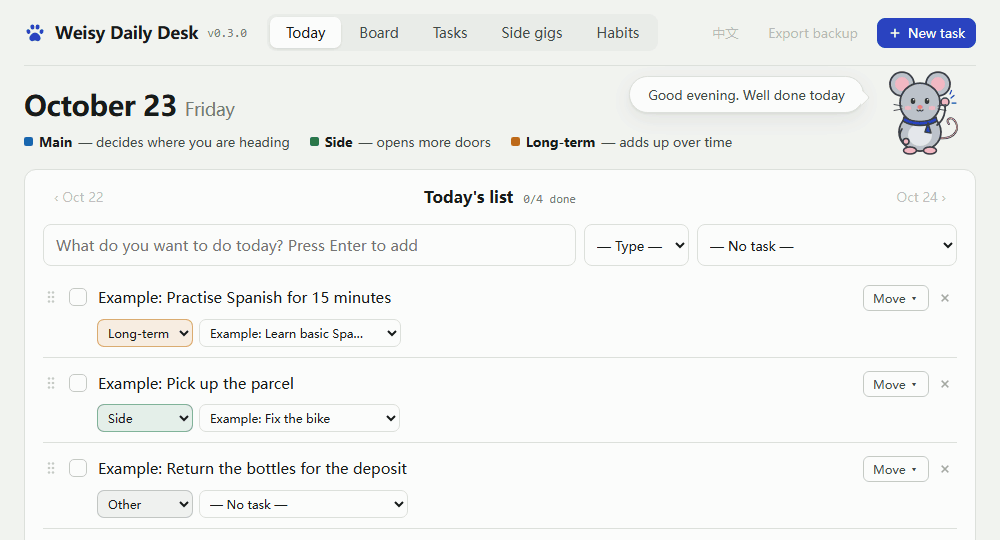
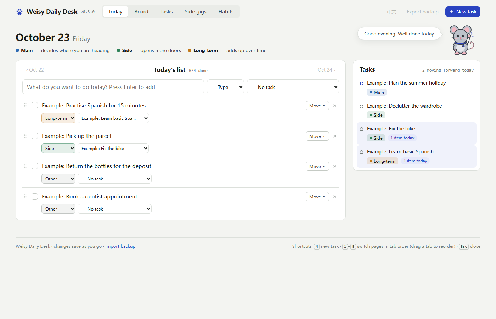
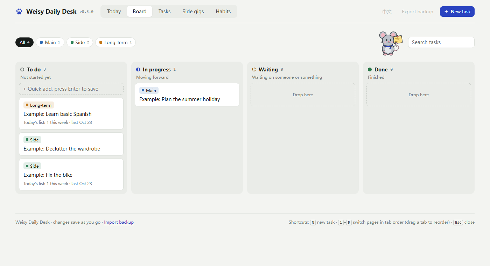
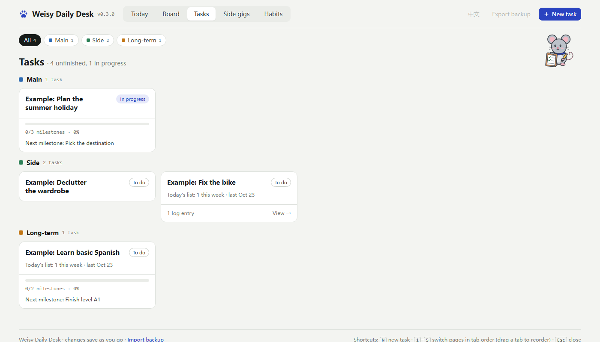
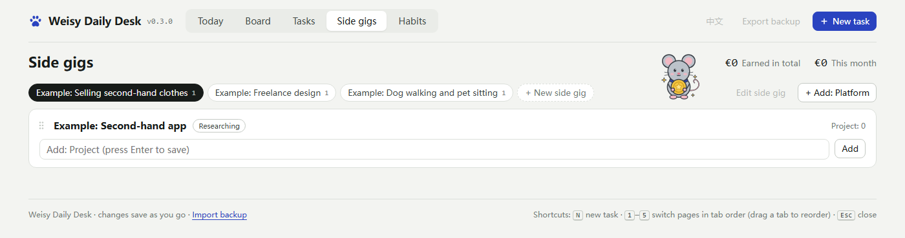
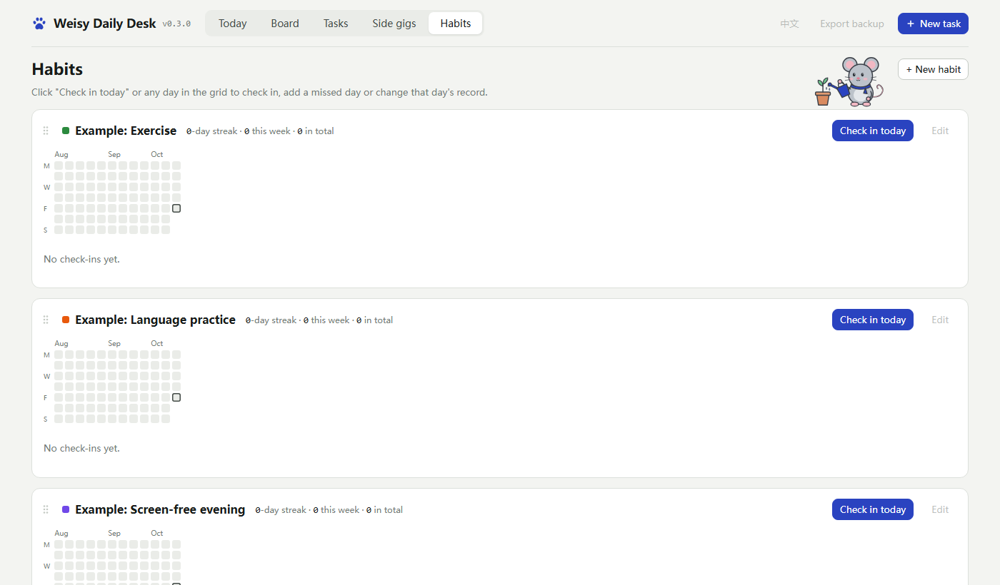

# Weisy · daily desk

**English** · [中文](README.zh-CN.md)

Weisy Daily Desk (Chinese name: 潦草鼠鼠之家) is a small personal workbench that runs entirely on your own computer: a today list,
a task board, milestones with an automatic progress log, side-project tracking and habit check-ins — with a little mouse
keeping you company. No account, no cloud, no tracking: your data is one JSON file on your disk.
It speaks **English and Chinese**: switch with one click at the top right.



## What's inside

| Page | What it does |
|---|---|
| Today | A list for the day. Give each item a type (main / side / long-term / other) and the task it belongs to (**Weisy can suggest the task while you type**). Finished items stay on their day; the mouse cheers when you tick one off. |
| Board | Drag tasks between To do / In progress / Waiting / Done. |
| Tasks | Every task grouped by type. Open one to see its next step, notes, milestones and **a progress log that is built automatically from the today-list items linked to it**. |
| Side gigs | Track side gigs, the platforms you use and what each one earned. |
| Habits | One-tap check-ins with a year heatmap, optional tags, minutes and notes. |







## Language

- The first time Weisy starts it follows your computer's language: Chinese on a Chinese system, English otherwise —
  the pages, the examples and the small first-run dialog.
- Switch at any time with **中文 / EN** at the top right. The choice is saved with your data.
- Switching changes Weisy's own words, and the examples you have not changed. Whatever you typed stays as you wrote it.
- The date picker and its calendar come from your browser, so they follow the browser's language.

## Quick start (Windows, nothing to install)

1. Open the [download page of the latest version](https://github.com/ellach123/weisy-daily-desk/releases/latest) — or, on this
   repository's front page, click the newest version under **Releases** on the right.
2. Under **Assets** at the bottom of that page, click **`Weisy-v…-windows.zip`** (`…` is the version number). The two
   "Source code" files next to it are the source code; you do not need them.
3. Right-click the downloaded file → *Extract All…*, and extract it wherever you like.
4. Open the extracted folder and double-click **`Weisy-daily-desk.exe`**. Weisy opens in its own window.

The first time, a small dialog asks you two things (**once you choose, you will not be asked again, so decide carefully**):
- **Where to keep your data.** If unsure, keep the default; to use your D: drive, click *Change* and pick a
  folder (not one inside the program folder).
- **Whether to put an icon on your desktop.**

Not sure yet? Just close the small window (×): Weisy quits without creating anything and asks again next time.

### Two messages you may see the first time

- **"Windows protected your PC"**: Weisy is a personal open-source project without a paid code-signing certificate,
  so Windows does not know its publisher — it has not found anything wrong. Click *More info* → *Run anyway*; the same
  file will not ask again.
- **An antivirus calls it suspicious**: some antivirus programs wrongly flag programs packaged with PyInstaller; this is
  a known false alarm. Every download is built, tested and published by GitHub straight from the public source code in
  this repository — the whole run is visible on the repository's Actions page. If you would still rather not run it,
  use *Running with Python* below to run the source code directly.

### Closing

Just close the Weisy window. About 10 seconds later the program stops by itself — there is nothing running in the background.

If you are about to delete or move the program folder, wait about 10 seconds after closing the window: until the program
has stopped, Windows says the files are in use and will not delete them.

### Updating (keeping your data)

1. Close Weisy.
2. **Note where your data is:** open `.weisy\location.txt` in the program folder with Notepad — the line in it is the
   path. If there is no such file, you are using the default place.
3. About 10 seconds after closing the window, delete the old program folder (your data is not inside it).
4. Download and extract the new version (steps 1–4 of *Quick start* above) and double-click `Weisy-daily-desk.exe`.
5. In the small dialog: if you used the default place, just click a start button; otherwise click *Change* and pick
   your old data folder again.

Your old data is picked up automatically: new version, old data. What changed in each version: [CHANGELOG](CHANGELOG.md).

## Running with Python (macOS, Linux, or to run the source code)

### Windows

1. Install [Python 3](https://www.python.org/downloads/) (tick "Add python.exe to PATH" during setup).
2. Download this repository (Code → Download ZIP) and unzip it.
3. Double-click **`start.bat`**. The first time, the same small dialog appears.

### macOS

1. Install [Python 3](https://www.python.org/downloads/) if `python3` is not available yet.
2. Download this repository (Code → Download ZIP) and unzip it anywhere.
3. Double-click **`start.command`**. The first time, macOS may refuse: right-click it, choose *Open*, and confirm.
   If it says the file cannot be run, run `chmod +x start.command` once in Terminal.
   Weisy opens in your default browser. (Not yet tested on a real Mac — please open an issue if something is off.)

### Linux

Run `sh start.command`, or `python3 tools/build.py` once, then `python3 server.py` and open <http://127.0.0.1:8780/>.

macOS / Linux have no dialog: the data goes to the default place (`~/.weisy-data/`). To use another folder, start
with `python3 server.py --data <folder>`. To keep the program running after the window is closed, start
`python3 server.py --keep-alive`.

Optional: in Edge or Chrome choose *Install this site as an app* to get a taskbar icon.
Opening Weisy again brings the existing window to the front.

## Your data

- Everything is saved in `weisy.json` as you type, in a folder **outside** the program folder. Default place:
  `C:\Users\<you>\AppData\Roaming\Weisy-Data\` on Windows, `~/.weisy-data/` on macOS and Linux.
  If you chose another place in the first-run dialog, the data is in a `Weisy-Data` folder inside the one you picked,
  and the default place is never created.
- The first run puts in three task types and a few examples (titled "Example: …", or 「示例：…」 in Chinese) — delete
  them whenever you like.
- Weisy's own two small notes (the data place you chose, and that you were asked) live in `.weisy` inside the program
  folder, so nothing is scattered around your computer.
- **Changing the folder later:** close Weisy, move the data folder to its new place, then edit the path in
  `.weisy\location.txt` with Notepad.
- **If the data folder cannot be found** (for example an unplugged drive), Weisy says so and refuses to start — it never
  quietly creates an empty set of data. Reconnect the drive and start again; to give up that place and start fresh,
  delete `.weisy\location.txt`.
- Before the first change of each day a copy goes to the `backups` folder inside the data folder (the last 30 days are kept).
- The page also has **Export backup** and **Import backup** for a JSON backup.
- The server only listens on `127.0.0.1` and refuses requests from other websites.
- To remove Weisy completely, close it, wait about 10 seconds, then delete the program folder, the desktop icon and the
  data folder — that is everything.
- (Developers: a `data/weisy.json` next to `server.py` is used first if it exists.)

## For developers

```
server.py              local server (Python standard library only)
launcher.py            what Weisy-daily-desk.exe runs: start.bat's job without needing Python
starter.json           data for the very first run: three task types and the examples (Chinese)
starter.en.json        the same in English (used when the system language is not Chinese)
VERSION                the version number (the only place it is kept)
CHANGELOG.md           what changed in each version (copied into the release notes)
start.bat              Windows launcher (Python)
start.command          macOS launcher (also works on Linux)
src/workbench.html     the page (HTML, CSS, JavaScript in one file)
src/local-store.js     data layer talking to server.py
src/vendor/            Sortable.js 1.15.2 (MIT) for drag and drop
src/assets/            icons and the mascot drawings (SVG)
tools/build.py         builds app/index.html from src/
tools/setup.ps1        first-run dialog on Windows (data folder, desktop shortcut)
tools/package.py       builds and smoke-tests dist/Weisy-v<version>-windows.zip
tools/release_notes.py prints one version's section of CHANGELOG.md
tools/make_demo_gif.py records docs/demo-zh.gif and docs/demo-en.gif
tools/make_screenshots.py takes the README screenshots in both languages
tools/make_icons.py    regenerates the icons
tests/                 end-to-end tests with fictional sample data
.github/workflows/     CI (tests on every push) and Release (package + publish on a version tag)
```

- Build: `python tools/build.py` (writes `app/`, which is not committed).
- Test: `python tests/test_local.py` — starts the server on port 8799 with `tests/sample-data.json`,
  runs `tests/test.js` in headless Microsoft Edge and checks the saved data; then runs `tests/test_en.js` on an
  English first run, which fails on any Chinese text left on an English page. Set `EDGE_PATH` if Edge
  is installed somewhere unusual.
- Languages: every text of the page is in the `I18N` table in `src/workbench.html` (中文 and English side by side).
  `WEISY_LANG=zh` or `WEISY_LANG=en` makes a first run (and the first-run dialog) use that language whatever the
  system language is.
- Developer tools: `python -m venv .venv`, then `.venv\Scripts\python -m pip install --no-cache-dir -r requirements-dev.txt`.
- Package (Windows): `.venv\Scripts\python tools\package.py` → `dist/Weisy-v<version>-windows.zip`, then unzips it
  and smoke-tests the real `Weisy-daily-desk.exe`. Everything it writes stays in `build/` and `dist/`.
- Release: update `VERSION` and `CHANGELOG.md`, push, then push a tag `v<version>`; the Release workflow tests,
  packages and publishes it.

## License

[MIT](LICENSE). The mouse drawings in `src/assets/mascots` are original artwork made for this project
and are covered by the same license.
