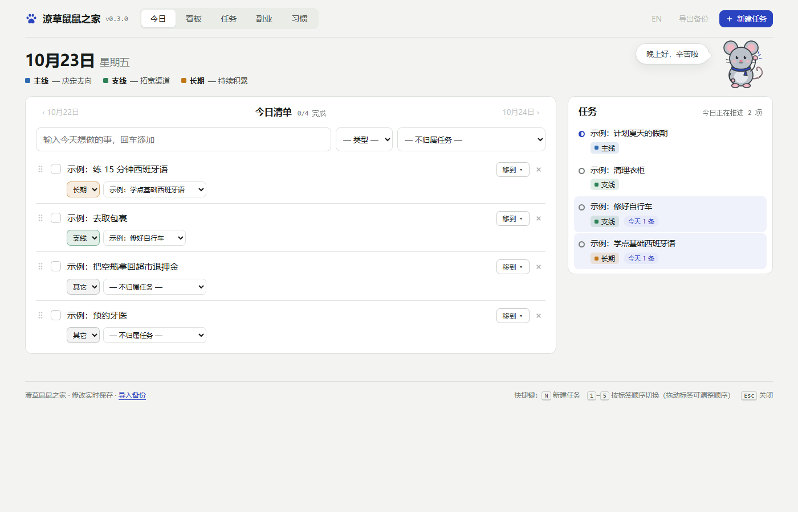
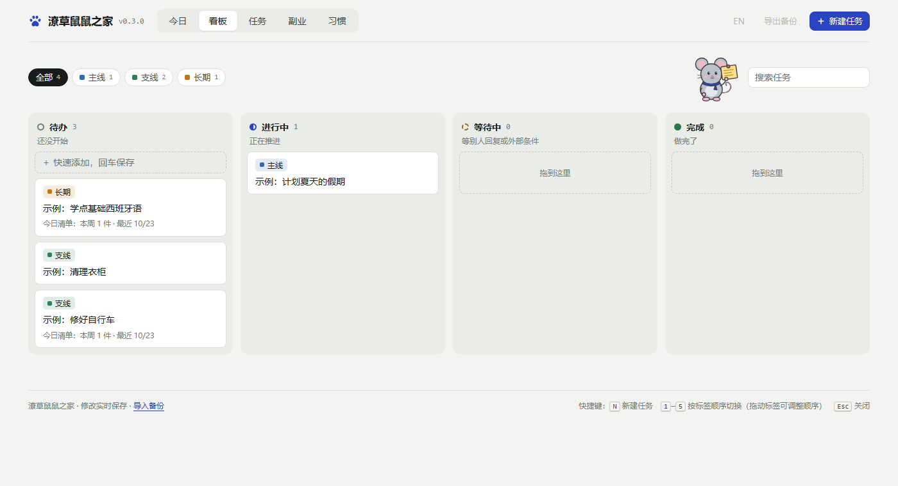
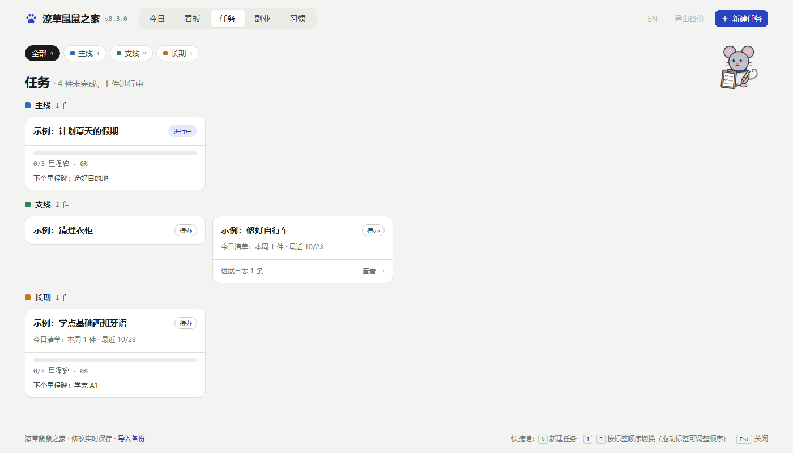
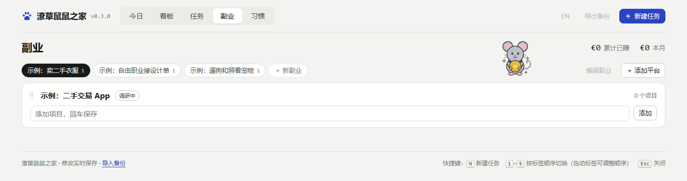
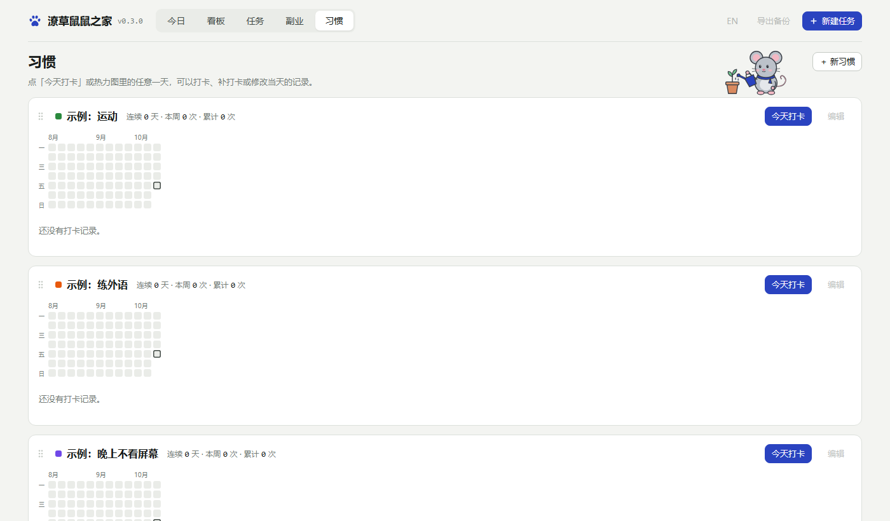

# 潦草鼠鼠之家

[English](README.en.md) · **中文**

潦草鼠鼠之家（英文名 Weisy）是一个完全运行在你自己电脑上的个人工作台：今日清单、任务看板、带自动进展日志的里程碑、副业记录和习惯打卡，还有一只小老鼠陪着你。
不需要注册账号，没有云端，也不收集任何数据：你的所有内容就是硬盘上的一个 JSON 文件。

## 有哪些功能

| 页面 | 用来做什么 |
|---|---|
| 今日 | 当天的清单。每一条可以选类型（主线 / 支线 / 长期 / 其它）和归属的任务，输入时会自动推荐所属任务。完成的条目会留在当天；每勾掉一项，小老鼠都会庆祝一下。 |
| 看板 | 把任务在 待办 / 进行中 / 等待中 / 完成 之间拖来拖去。 |
| 任务 | 按类型列出所有任务。点开一个任务，可以看到下一步、备注、里程碑，以及由今日清单自动生成的进展日志。 |
| 副业 | 记录你的副业、用到的平台和每一项的收入。 |
| 习惯 | 一键打卡，带一整年的热力图，可以记录选项、时长和笔记。 |

## 快速开始（Windows，不用装任何东西）

1. 打开[最新版本的下载页面](https://github.com/ellach123/weisy-daily-desk/releases/latest)。也可以在这个仓库首页右侧的 **Releases** 里，点最新的版本号进入。
2. 在页面下方的 **Assets** 里，点 **`Weisy-v…-windows.zip`** 下载（`…` 是版本号）。旁边两个「Source code」是源代码，不用下载。
3. 在下载的文件上点右键 →「全部解压缩」，解压到你喜欢的位置。
4. 打开解压出来的文件夹，双击 **`Weisy-daily-desk.exe`**，潦草鼠鼠之家会在独立窗口中打开。

第一次打开时，会弹出一个小窗口，让你做两个选择（**选好之后就不会再问，请慎重考虑**）：
- **数据保存在哪里。** 不确定就用默认位置；想放在 D 盘，点「更改…」选一个文件夹（不要选程序文件夹里面）。
- **要不要在桌面放一个图标。**

还没想好？点小窗口右上角的 × 就行：软件会直接退出，什么都不会创建，下次打开再问。

### 第一次打开时可能看到的两个提示

- **「Windows 已保护你的电脑」**：这是因为潦草鼠鼠之家是个人开源项目，没有购买数字签名证书，Windows 不认识它的发布者，并不是发现了问题。点「更多信息」→「仍要运行」即可，同一个文件以后不会再提示。
- **杀毒软件报"可疑"**：个别杀毒软件会把用 PyInstaller 打包的程序误判为可疑，这是常见的误报。每个下载包都由 GitHub 直接从这里公开的源代码自动打包、测试并发布，你可以在仓库的 Actions 页面看到全过程。如果仍不放心，可以用下面「用 Python 运行」的方式，直接运行源代码。

### 怎么关

直接关掉潦草鼠鼠之家的窗口就行。大约 10 秒后程序会自己退出，后台不会留下任何东西。

如果接下来要删除或移动程序文件夹，请在关窗口后等大约 10 秒再动手：程序还没退出时，Windows 会提示"文件正在使用"，删不掉。

### 怎么更新（保留旧数据）

1. 关掉软件。
2. **先记下数据文件夹在哪**：用记事本打开程序文件夹里的 `.weisy\location.txt`，里面那一行就是路径。如果没有这个文件，说明你用的是默认位置。
3. 关窗口后等大约 10 秒，再删掉旧的程序文件夹（放心，你的数据不在里面）。
4. 按上面「快速开始」的第 1–4 步，下载、解压新版本，双击 `Weisy-daily-desk.exe`。
5. 在弹出的小窗口里：用的是默认位置就直接点「开始」；否则点「更改…」，选回原来的数据文件夹。

旧数据会自动接上，你会看到新版本、老数据。每个版本改了什么，见 [更新记录](CHANGELOG.md)。

## 用 Python 运行（macOS、Linux，或想直接运行源代码）

### Windows

1. 安装 [Python 3](https://www.python.org/downloads/)（安装时勾选 “Add python.exe to PATH”）。
2. 下载这个仓库（Code → Download ZIP），解压。
3. 双击 **`start.bat`**。第一次同样会弹出上面那个小窗口。

### macOS

1. 如果还没有 `python3`，先安装 [Python 3](https://www.python.org/downloads/)。
2. 下载这个仓库（Code → Download ZIP），解压到任意位置。
3. 双击 **`start.command`**。第一次 macOS 可能会拒绝：右键点它，选「打开」，再确认一次。
   如果提示无法运行，在终端执行一次 `chmod +x start.command`。
   潦草鼠鼠之家会在默认浏览器中打开。（还没有在真正的 Mac 上测试过，有问题欢迎提 issue。）

### Linux

运行 `sh start.command`；或者先运行一次 `python3 tools/build.py`，然后运行 `python3 server.py`，再打开 <http://127.0.0.1:8780/>。

macOS / Linux 没有那个小窗口：数据放在默认位置（`~/.weisy-data/`）。想放别处，用 `python3 server.py --data 文件夹路径` 启动。
想让程序一直开着（关窗口也不退出），用 `python3 server.py --keep-alive` 启动。

可选：在 Edge 或 Chrome 里选择「将此站点作为应用安装」，任务栏上就会有自己的图标。再次打开时，会直接切换到已经打开的窗口。

## 你的数据

- 所有内容实时保存在 `weisy.json` 里，放在程序文件夹**之外**。默认位置：Windows 是 `C:\Users\你的用户名\AppData\Roaming\Weisy-Data\`，macOS / Linux 是 `~/.weisy-data/`。
  你在第一次打开的小窗口里选了别的位置，就保存在你选的文件夹里的 `Weisy-Data` 中，默认位置不会被创建。
- 第一次运行会放进三个任务类型和几条示例（标题以「示例：」开头），看完删掉即可。
- 程序自己的两个小记录（你选的数据位置、有没有问过你）放在程序文件夹里的 `.weisy` 里，不会散落到别处。
- **以后想换位置：** 关掉软件，把数据文件夹搬到新位置，再用记事本把 `.weisy\location.txt` 里的路径改成新位置。
- **找不到数据文件夹时**（比如 U 盘没插上），软件会提示并拒绝启动，不会悄悄新建一份空数据。插好再启动；想放弃这个位置重新开始，删掉 `.weisy\location.txt`。
- 每天第一次修改前，会自动复制一份到数据文件夹里的 `backups` 文件夹（保留最近 30 天）。
- 页面底部有「导出备份」和「导入备份」，可以导出或恢复一份 JSON 备份。
- 本地程序只在 `127.0.0.1` 上运行，并拒绝来自其他网站的请求。
- 想彻底删除：关掉软件、等大约 10 秒，再删掉程序文件夹、桌面图标和数据文件夹，这三样就是全部。
- （开发者：如果 `server.py` 旁边有 `data/weisy.json`，会优先使用它。）

## 开发者

文件结构、构建、打包、测试和发布方法见 [English README](README.en.md#for-developers)。

## 许可证

[MIT](LICENSE)。`src/assets/mascots` 里的小老鼠是为本项目原创的图画，同样使用 MIT 许可证。
